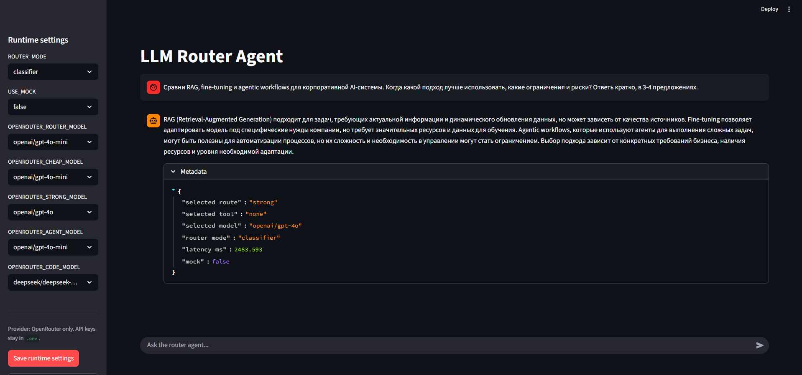

# LLM Router Agent：多模型路由与工具调用系统

基于 FastAPI 和 Streamlit 的多模型路由项目。系统先判断用户请求适合 `cheap`、`strong` 还是 `agent` 路径，再调用相应模型；Agent 路径可由模型自主决定是否使用搜索、仓库分析或代码辅助工具。项目支持无密钥的 mock 演示，以及通过 OpenAI 或 OpenRouter 调用真实模型。



## 功能概览

- **三种路由策略**：规则路由 `rules`、TF-IDF + Logistic Regression 分类器 `classifier`、由模型输出结构化决策的 `llm`。
- **三个执行路径**：`cheap` 处理简单请求，`strong` 处理复杂推理，`agent` 处理可能需要工具的请求。实际模型名称由配置决定。
- **重试与升级**：真实模型调用失败后，单次请求最多额外重试 `MODEL_MAX_RETRIES` 次；仍失败则依次尝试 `cheap → strong → agent`。Agent 是最后一级。
- **模型自主调用工具**：真实 Agent 使用 Tool Calling，可直接回答，也可串行调用多个工具。工具名和 JSON 参数经显式注册表验证。
- **会话记忆**：Streamlit 在当前会话中保留最近的用户消息与模型回答，默认最多六轮；超出后移除最早的完整轮次。
- **可观测的接口结果**：返回初始路由、实际执行路由、决策原因、置信度、工具、回退记录、耗时和静态成本估算。
- **离线评测与测试**：提供 JSONL 样本、路由评测脚本与 pytest 测试。

```text
Streamlit UI / HTTP 客户端
          ↓
FastAPI：/health、/route、/chat
          ↓
路由器：rules / classifier / llm
          ↓
cheap 模型 → strong 模型 → agent 模型
                              ↓
             web_search / repo_analysis / code_assistant
```

## 快速开始

建议使用 Python 3.10+。在项目根目录执行以下命令。Windows PowerShell：

```powershell
python -m venv .venv
.\.venv\Scripts\python.exe -m pip install -r requirements.txt
Copy-Item .env.example .env
.\.venv\Scripts\python.exe -m pytest
```

Linux / macOS：

```bash
python3 -m venv .venv
./.venv/bin/python -m pip install -r requirements.txt
cp .env.example .env
./.venv/bin/python -m pytest
```

默认 `USE_MOCK=true`，无需模型 API Key 即可测试接口与界面。Windows 还可运行 `./scripts/bootstrap_env.ps1`，它会检查 Python、创建或修复 `.venv`、安装依赖并执行 pytest；以后可用 `./scripts/run_tests.ps1` 单独运行测试。

启动 FastAPI：

```powershell
.\.venv\Scripts\python.exe -m uvicorn app.main:app --reload
```

打开 [交互式 API 文档](http://127.0.0.1:8000/docs)。在另一个终端启动 Streamlit：

```powershell
.\.venv\Scripts\python.exe -m streamlit run app_ui.py
```

如果在 Linux / macOS 上运行，把上述 `python.exe` 路径替换为 `./.venv/bin/python`。Streamlit 默认连接本机 `http://127.0.0.1:8000` 的后端，因此要先启动 FastAPI。

## 配置 mock 与真实 API

项目通过 `app/config.py` 中的 `load_dotenv()` 读取根目录的 `.env`。可以从 [`.env.example`](.env.example) 复制模板；不要把真实密钥提交到 Git。

```env
# 无需外部模型 API 的演示
ROUTER_MODE=rules
USE_MOCK=true
```

调用 OpenRouter：

```env
USE_MOCK=false
LLM_PROVIDER=openrouter
OPENROUTER_API_KEY=填入自己的密钥
OPENROUTER_BASE_URL=https://openrouter.ai/api/v1
OPENROUTER_CHEAP_MODEL=openai/gpt-4o-mini
OPENROUTER_STRONG_MODEL=openai/gpt-4o
OPENROUTER_AGENT_MODEL=openai/gpt-4o-mini
```

调用 OpenAI：

```env
USE_MOCK=false
LLM_PROVIDER=openai
OPENAI_API_KEY=填入自己的密钥
OPENAI_CHEAP_MODEL=gpt-4o-mini
OPENAI_STRONG_MODEL=gpt-4o
```

模型 ID 只是示例；请按自己的账号可用模型配置。Agent 模型必须支持 Tool Calling。选择 OpenAI 时，Agent 使用 `OPENAI_STRONG_MODEL`；选择 OpenRouter 时，使用 `OPENROUTER_AGENT_MODEL`。`OPENROUTER_CODE_MODEL` 是保留的兼容配置，当前 Tool Calling 流程不使用它。

| 配置项 | 作用 |
|---|---|
| `ROUTER_MODE=rules` | 使用关键词、请求长度等规则选择路径。 |
| `ROUTER_MODE=classifier` | 使用仓库中的 `models/router_classifier.pkl` 进行分类。 |
| `ROUTER_MODE=llm` | 真实模式调用路由模型并校验 JSON 决策；失败时回退到规则路由。mock 模式直接使用规则路由。 |
| `OPENROUTER_ROUTER_MODEL` | 选择 OpenRouter 且启用 `llm` 路由时，用于**判断路径**的模型，不是 Agent 回答模型。 |
| `MODEL_MAX_RETRIES=2` | 每次模型请求首次失败后最多额外重试两次；配置值最多按五次额外重试处理。 |
| `AGENT_MAX_TOOL_CALLS=3` | 单轮 Agent 最多执行三个模型请求的工具调用。 |
| `AGENT_ENABLED=false` | `agent` 路径只调用其模型，不提供工具。 |

在 UI 侧边栏保存的非密钥设置存放于 `config/runtime_config.json`，它优先于 `.env` 中对应的路由模式、服务商和模型 ID。修改 `.env` 的模型名称后，可点击侧边栏 **Load model IDs from .env** 再保存运行时设置；修改 API Key 后需要重启 FastAPI。运行时配置模板见 [`config/runtime_config.example.json`](config/runtime_config.example.json)。密钥始终只从环境变量或 `.env` 读取。

## API 用法

| 接口 | 说明 |
|---|---|
| `GET /health` | 返回服务状态与版本。 |
| `POST /route` | 只做路由决策，返回路径、置信度、信号和回退计划；不调用回答模型。 |
| `POST /chat` | 根据 `messages` 中最近的用户消息路由，并调用 mock 或真实模型生成回答。 |

PowerShell 请求示例：

```powershell
Invoke-RestMethod http://127.0.0.1:8000/health

$routeBody = @{ query = '帮我搜索最新的 FastAPI 文档' } | ConvertTo-Json
Invoke-RestMethod http://127.0.0.1:8000/route -Method Post -ContentType 'application/json' -Body $routeBody

$chatBody = @{ messages = @(@{ role = 'user'; content = '你好，请介绍一下这个项目' }) } | ConvertTo-Json -Depth 5
Invoke-RestMethod http://127.0.0.1:8000/chat -Method Post -ContentType 'application/json' -Body $chatBody
```

`/chat` 的输入仍是 `messages: [{role, content}, ...]`。`route_type` 表示初始决策，`executed_route` 表示重试和升级后实际运行的路径，`fallback_history` 记录升级过程；`selected_tools` 按调用顺序列出工具。`estimated_cost_usd` 和 `estimated_latency_ms` 是**初始路径的静态预估**，不是实际 API 账单或重试后的实测成本；`latency_ms` 是本次请求耗时。所有执行路径失败时，接口返回 HTTP 502。

## Agent 工具与会话记忆

真实模式中，程序向支持 Tool Calling 的模型发送三个工具定义，并设置自动选择、关闭并行调用。模型可以直接返回文本；若要求调用工具，程序执行并把 assistant 工具调用消息及对应 `tool_call_id` 的结果加入本轮历史，再请求模型决定下一步。因此模型可以先搜索，再根据结果调用另一个工具。

| 工具 | 作用 |
|---|---|
| `web_search` | 用 Tavily 查询实时网页；mock 模式返回演示结果。 |
| `repo_analysis` | 有边界地分析本地或公开 GitHub 仓库，过滤常见敏感信息。 |
| `code_assistant` | 针对报错、测试、接口实现等问题给出静态分析和建议，不执行代码。 |

工具通过明确的 allowlist 注册。每次调用只接受包含非空字符串 `query` 的 JSON 对象；未知工具、非法 JSON、缺失或错误类型的参数会得到安全的工具错误结果。程序不会执行模型生成的 Python 代码，也不会把模型参数当作任意文件路径读取。

真实网页搜索还需在 `.env` 中配置 `TAVILY_API_KEY`，并保持 `WEB_SEARCH_MOCK=false`。缺少密钥、密钥无效、额度不足或网络故障会返回对应工具错误；安装依赖需包含 `tavily-python`。mock 模式没有真实模型选择工具，因此使用确定性演示逻辑。

Streamlit 默认保存最近六轮完整对话，即用户消息和模型回答，并随下次 `/chat` 请求一起发送。侧边栏 **Memory turns** 可调整轮数，**Clear conversation** 可清空。记忆仅存在当前 UI 会话中；关闭会话后不持久化，单条很长的消息也不会被自动压缩。Agent 的单轮工具调用记录不会跨不同 `/chat` 请求保存。

## 测试与离线评测

```powershell
.\.venv\Scripts\python.exe -m pytest
.\.venv\Scripts\python.exe scripts/evaluate_router.py --dataset data/eval_test_queries.jsonl
.\.venv\Scripts\python.exe scripts/evaluate_router.py --dataset data/eval_test_queries.jsonl --output reports/evaluation_results.json
```

测试使用 mock 或替身响应，不需要调用真实 Tavily。评测脚本读取 JSONL 文件，输出总体准确率、各路径准确率、混淆矩阵等；带 `--output` 时生成附有时间戳的本地报告。`reports/*.json` 不提交到 Git。若要重新训练分类器，运行 `python scripts/train_router_classifier.py`。仓库中已保存的模型基于 `scikit-learn==1.6.1`；更换该版本后应重新训练。

在项目自带的 300 条测试样本上，当前规则路由正确 `225/300`（75.0%），当前分类器正确 `265/300`（88.3%）。这是**两种现有策略在该数据集上的对比**，并非与原版项目的严格对照，也不代表线上准确率、成本或延迟提升。

## 项目结构

```text
app/                  FastAPI、路由、模型服务商与 Agent 工具
app_ui.py             Streamlit 演示界面
config/               可提交的运行时配置模板
data/                 JSONL 训练和评测样本
docs/                 截图与项目优化总结
models/               已训练的路由分类器
scripts/              环境准备、训练和评测脚本
tests/                pytest 测试
.env.example          不含真实密钥的配置模板
requirements.txt      Python 依赖
```

更完整的功能改造、评测口径与当前限制见 [项目优化总结](docs/项目优化总结.md)。原项目的俄语问卷、Word 文档和演示文稿仍保留在仓库中。

## 当前限制

- 成本与延迟预估是静态档位，尚未根据服务商 usage 和实际账单统计真实费用。
- UI 会话记忆没有数据库持久化，也没有按 token 精确裁剪。
- 使用真实搜索前须准备有效的 Tavily 密钥；当前仓库不包含任何可用密钥。

## 许可证

见 [LICENSE](LICENSE)。
